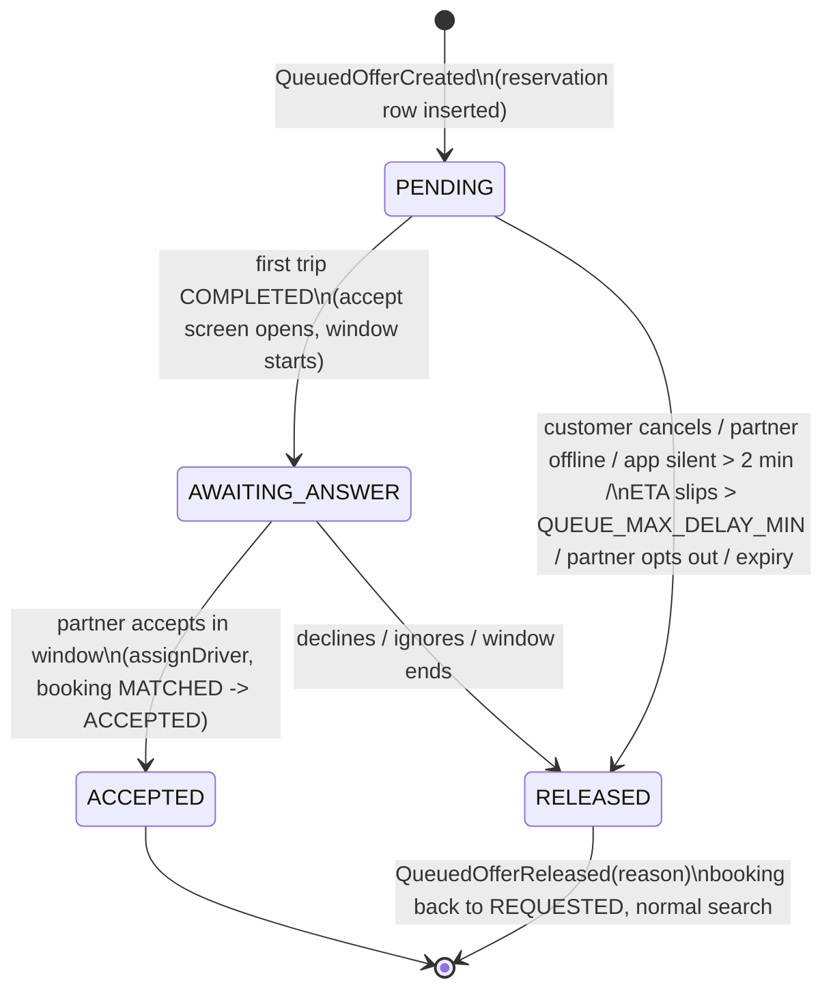

# Queued offers: a partner finishing a trip gets the next request (design, awaiting approval)

Status: **design only.** Nothing here is built. It's behind
`QUEUED_OFFERS_ENABLED=false` once built. The facts it relies on are in
`docs/parcel-dispatch-audit.md`, section B.

## Recommendation

**Yes, narrowly, and switched off until the numbers say otherwise.** Big apps
chain trips because idle time between trips is their largest efficiency loss
and their biggest cause of "no partner found." SheOut's risk is different:
few partners, women on two-wheelers, and a promise that the first customer
always comes first. So:

- **Bike taxi only.** A parcel never chains, and a ride never chains to a
  parcel or the other way round.
- **Opt-in per partner**, off by default.
- **Considered last:** only when the free-partner search finds nobody.
- **No interruption while she rides:** the accept screen appears only after
  she taps End trip.
- **Measure first:** the metrics below ship before the flag is ever turned
  on. If no-partner-found is rare, it stays off.

## One constraint I'd change, with evidence

"Only after the normal expansion limit" means only after free partners up to
**24 km** have had their chance (3 → 6 → 12 → 24 km, audit B.2). A free
partner 20 km away is about an hour off at city speed. Under the rule as
written she beats a partner finishing a trip 800 m away. Proposal: the queued
round runs as the **last round of the same search**, and a free partner
still wins **only if her road ETA ≤ the finishing partner's predicted ETA +
`QUEUE_PREFER_FREE_WITHIN_MIN` (3)**. Free partners stay first in every
earlier round, exactly as today.

## Who qualifies as "finishing"

All of these, checked live at offer time and again at accept:

1. Has turned on "Accept next trip while finishing" (users module setting,
   default off).
2. Her current booking is **IN_PROGRESS**, never MATCHED or ACCEPTED (heading
   to or waiting at a pickup).
3. Both bookings are **BIKE** taxi.
4. She holds **no queued offer** and no live offer.
5. Remaining time to drop ≤ `QUEUE_MAX_REMAINING_MIN` (3) **or** remaining
   distance ≤ `QUEUE_MAX_REMAINING_KM` (1.0).
6. Drop → new pickup ≤ `QUEUE_MAX_PICKUP_AFTER_DROP_MIN` (5).
7. Every other `isAvailableNow` rule except "no active trip": online,
   verified, valid shift selfie, not blocked, not the customer herself, test
   partners only for test riders.
8. A fresh location (< 2 min).

## ETA

`predicted_arrival = (remaining_to_drop + drop_to_new_pickup) × (1 + QUEUE_ETA_BUFFER_PCT/100)`

Both legs come from OSRM. The remaining leg is a route call from her last fix
to her drop. The drop → pickup legs for all candidates are **one `table`
call** (sources: the candidates' drops; destination: the new pickup). OSRM
lives in booking (`booking/internal/fare/OsrmRouteProvider.java`), so booking
publishes a small `RoutingApi` (`route(a, b)`, `durations(sources, dest)`)
and dispatch calls that. No module reaches into another's internals. If
OSRM is down, there's **no queued offer**; we never fall back to straight
lines for a promise made to a customer.

The customer is shown the predicted arrival, rounded **up** to a whole
minute. It's recomputed on every location report from the partner.

## State machine



On the booking side there's one new status, **`QUEUED`**:
`REQUESTED → QUEUED → MATCHED` on accept, `QUEUED → REQUESTED` on release,
and `QUEUED → CANCELLED` (free, never counted against her). The partner is
not assigned (no `driver_id`) until she accepts. That keeps "one active trip
per partner" true at all times, and lets the database enforce it (below).

## Sequence

```mermaid
sequenceDiagram
    participant C as Customer B
    participant BK as booking
    participant D as dispatch
    participant R as RoutingApi (OSRM)
    participant P as Partner (on trip A)
    C->>BK: request bike taxi
    BK-->>D: BookingRequested
    D->>D: rounds 1..3, free partners only: nobody
    D->>D: last round: free candidates + finishing candidates
    D->>R: durations(finishing drops -> B pickup), route(P -> A drop)
    R-->>D: legs
    D->>D: pick best; free wins unless slower by > QUEUE_PREFER_FREE_WITHIN_MIN
    D->>D: INSERT queued_offers (unique per partner, per booking)
    D-->>BK: QueuedOfferCreated
    BK->>BK: B: REQUESTED -> QUEUED
    BK-->>C: "Your partner is finishing another trip. Arriving in about 11 min"
    D-->>P: small banner + one soft chime (final phase only)
    loop each location report
        D->>R: re-estimate; if slip > QUEUE_MAX_DELAY_MIN -> release
    end
    P->>BK: End trip A (unchanged rules)
    BK-->>D: BookingCompleted(A)
    D-->>P: accept screen for B (window QUEUE_ACCEPT_WINDOW_SECONDS)
    alt accepts
        P->>D: accept
        D->>BK: assignDriver(B, P), then the usual accept
        D-->>BK: QueuedOfferAccepted
    else declines / ignores / expires
        D-->>BK: QueuedOfferReleased(reason)
        BK->>BK: B: QUEUED -> REQUESTED, fresh search
        BK-->>C: "We're finding you another partner"
    end
```

## Safety: what she sees while riding

| Option | What she sees | Verdict |
|---|---|---|
| A. Full-screen offer, as today | Takes over the navigation screen mid-ride | **Rejected.** That's the distraction we're avoiding |
| B. Passive banner during the final phase, accept after End trip | A slim, non-tappable line under the nav header ("Next trip waiting near your drop"), one soft chime, no countdown. The accept/decline screen opens after End trip | **Recommended** |
| C. Nothing until End trip | No signal at all; the offer appears at the drop | Safest, but she can't plan the last minute (where to stop). Fallback if B tests badly |

In B the banner can't be tapped, so nothing invites a hand off the
handlebar. The chime plays once and only if she hasn't muted offer sounds.
The accept window starts at End trip, not at offer time, and declining or
ignoring it carries **no penalty** (no acceptance-rate hit, nothing on her
record).

## What customer B is told

- **While queued:** "Your partner is finishing another trip nearby.
  Arriving in about 11 min." The ETA is real and is never shown as a range
  that hides the delay. **Nothing** about the other customer (no location,
  no name, no drop).
- **Cancel is free at any time before the partner starts moving to her**,
  meaning before ACCEPTED, and isn't counted against her.
- **If the first trip runs late** and the arrival estimate passes the
  promise + `QUEUE_MAX_DELAY_MIN` (5): released automatically, with "Your
  partner's trip is running late, so we're finding you someone else." The
  search starts fresh with its own full budget.

**The first customer always comes first.** Nothing in this flow touches trip
A: no route change, no detour, no new pickup point. The partner's
navigation, the End trip rule and the drop geofence stay exactly as they are.

## Concurrency

The guarantee is in the database, not in check-then-write code.

```sql
-- V79+ (number decided at build time)
create table queued_offers (
  id               uuid primary key,
  booking_id       uuid not null,            -- customer B
  partner_id       uuid not null,
  current_booking_id uuid not null,          -- trip A
  status           varchar(20) not null,     -- PENDING, AWAITING_ANSWER, ACCEPTED, RELEASED
  promised_arrival timestamptz not null,
  answer_by        timestamptz,
  release_reason   varchar(40),
  created_at       timestamptz not null default now(),
  closed_at        timestamptz
);
-- at most one live queued offer per partner, and per booking
create unique index uq_queued_offers_partner on queued_offers (partner_id) where status in ('PENDING','AWAITING_ANSWER');
create unique index uq_queued_offers_booking on queued_offers (booking_id) where status in ('PENDING','AWAITING_ANSWER');
-- and, closing the gap in audit B.3: at most one active trip per partner
create unique index uq_bookings_one_active_trip on bookings (driver_id)
  where status in ('MATCHED','ACCEPTED','IN_PROGRESS');
```

The last index is worth having even if Part 2 is never switched on. Before it
is created, run a read-only check on prod for existing violations (same
practice as the V79 audit).

| Case | What happens |
|---|---|
| Two customers race for the same finishing partner | Both INSERT; the partial unique index lets one win. The loser gets a unique violation, which is treated as "not available," and its search continues |
| Partner accepts after expiry | Accept is an `UPDATE … WHERE status='AWAITING_ANSWER' AND answer_by > now()`; 0 rows means 404 |
| First trip completes early | Normal: the accept window starts sooner. The promise to B only improves |
| First trip cancelled | Can't happen from IN_PROGRESS today. If an admin ends it, BookingCancelled/Completed releases or promotes the same way |
| Partner goes offline or turns the setting off | Users event → release (reason PARTNER_OFFLINE / OPTED_OUT) |
| App killed, no location for > 2 min | The sweeper releases (APP_SILENT). The same 2-minute freshness rule as today |
| B cancels | BookingCancelled → release (CUSTOMER_CANCELLED) |
| Two servers sweeping | The existing `ClusterLock` on the sweep, plus the conditional UPDATEs above |
| Promote at End trip races release | Both are conditional UPDATEs on `status`; exactly one changes the row |

The sweeper reuses `DispatchRetrySweeper` with a second task under the same
lock.

## Domain events

All are published by dispatch, and booking listens for them:

- `QueuedOfferCreated(bookingId, partnerId, promisedArrival)`
- `QueuedOfferAwaitingAnswer(bookingId, partnerId, answerBy)`
- `QueuedOfferAccepted(bookingId, partnerId)`
- `QueuedOfferReleased(bookingId, partnerId, reason)`, where reason is one
  of CUSTOMER_CANCELLED, PARTNER_DECLINED, ANSWER_TIMEOUT, DELAYED,
  PARTNER_OFFLINE, APP_SILENT, OPTED_OUT, ROUTING_UNAVAILABLE

Booking moves its own status on each one. Dispatch never writes booking
tables, and booking never reads `queued_offers`.

## Config

| Key | Default | Meaning |
|---|---|---|
| `QUEUED_OFFERS_ENABLED` | `false` | Master switch |
| `QUEUE_PREFER_FREE_WITHIN_MIN` | 3 | A free partner wins unless more than this slower |
| `QUEUE_MAX_REMAINING_MIN` | 3 | Remaining time to her drop |
| `QUEUE_MAX_REMAINING_KM` | 1.0 | …or remaining distance |
| `QUEUE_MAX_PICKUP_AFTER_DROP_MIN` | 5 | Her drop → the new pickup |
| `QUEUE_ETA_BUFFER_PCT` | 20 | Added to the predicted arrival |
| `QUEUE_MAX_DELAY_MIN` | 5 | Release B when the estimate slips this far past the promise |
| `QUEUE_ACCEPT_WINDOW_SECONDS` | 20 | Her answer window, starting at End trip |
| `QUEUE_CATEGORIES` | `BIKE` | Which categories may chain (bike taxi only) |

## Measure first (ships before the flag is turned on)

New table `dispatch_offer_log` (dispatch's own, insert-only): booking,
partner, round, radius, distance, offered_at, answered_at, outcome
(ACCEPTED, DECLINED, EXPIRED, WITHDRAWN), queued flag. Plus SQL views read
by a new "Dispatch" card in the admin console:

| Metric | Source |
|---|---|
| No-partner-found rate | bookings with status NO_DRIVERS_AVAILABLE ÷ all requested, per day and hour |
| Time to match (p50/p90) | `matched_at - created_at` |
| Acceptance rate | offer log: ACCEPTED ÷ offered |
| Offers per partner per hour | offer log, grouped |
| Cancellation after match | `cancelled_at` with `matched_at` set, by who cancelled |
| Queued: promised vs actual arrival | `queued_offers.promised_arrival` vs B's pickup verified time |
| Queued: release reasons | `queued_offers.release_reason` |

**Turn-on rule (suggested):** two weeks of data, and a no-partner-found rate
above 10% in some hours of the service window.

## Tests (when built)

- **Unit:** eligibility (each rule on its own, including phase, category,
  opt-in, existing offer, the remaining-time OR distance rule, and drop →
  pickup); ETA arithmetic including the buffer and rounding up; the
  free-vs-finishing comparison at the boundary.
- **Integration (real Postgres and Redis, stubbed RoutingApi):** queued →
  End trip → accept → MATCHED/ACCEPTED; decline → fresh search; delay
  release; offline release; customer cancel.
- **Concurrency:** 50 parallel bookings against 5 finishing partners. Assert
  each partner holds ≤ 1 live queued offer and ≤ 1 active trip, every
  booking is either queued to exactly one partner or still searching, and
  there are no duplicate assignments. Run 20 times.
- **Load:** re-run `loadtest/sheout-load.mjs` before and after. Compare
  error rate, p95 latency, heap and connection-pool waits (local Postgres
  allows 20 connections, so the harness notes apply).

## Risks

| Risk | Mitigation |
|---|---|
| Promises B can't keep (traffic, a slow drop) | 20% buffer, live re-estimate, automatic release at +5 min, honest copy |
| Distracting the partner | No interactive UI while moving; accept only after End trip; opt-in |
| Pressure on the partner to rush trip A | No penalty for declining; no countdown shown while riding; we don't show B's fare until End trip |
| The payment hold (audit A.6) holds her for 10 min after trip A while A is unpaid | **Decision Q4** below; until it's decided, a queued offer can't be promoted while A is unpaid |
| OSRM down | No queued offers at all (ROUTING_UNAVAILABLE); free-partner search unaffected |
| Customers in queued state forever | Every state has an expiry; the sweeper releases |
| New database constraint fails on existing data | Read-only prod check first; the migration needs your OK (same practice as V79) |

## Decisions for you (Part 2)

- **Q1** Approve the narrow design: bike only, opt-in, last round, flag off.
- **Q2** Approve changing "after the normal expansion limit" to "last round,
  free wins unless more than 3 min slower" (the 24 km evidence above).
- **Q3** Safety UI: option B (recommended) or C.
- **Q4** Payment hold: let a queued pickup go ahead while trip A is still
  unpaid? Customer A remains blocked from booking until she pays, so the
  money stays protected. Recommended: yes for queued offers only.
- **Q5** After a release, does B's fresh search get a full new 90 s budget?
  Recommended: yes.
- **Q6** The turn-on rule.
